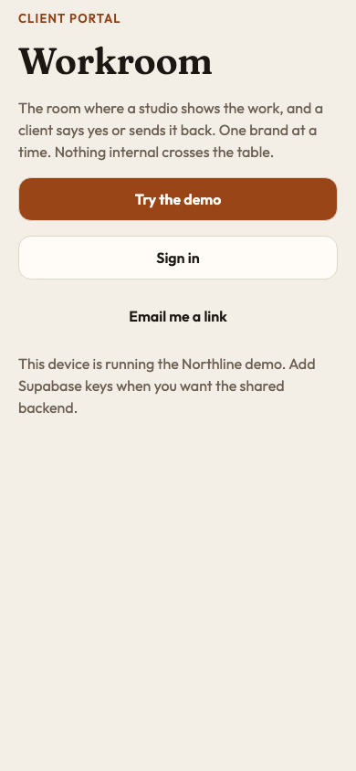
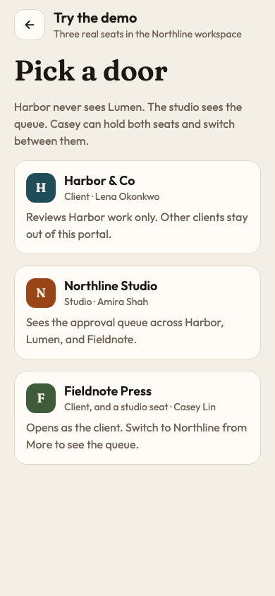
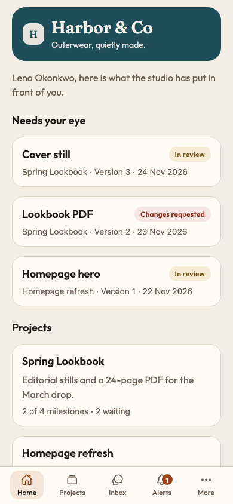
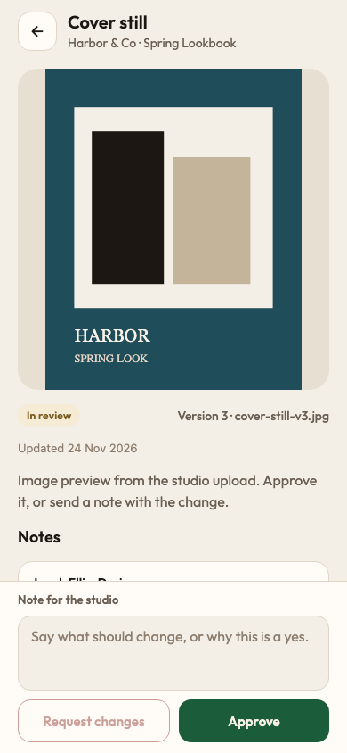
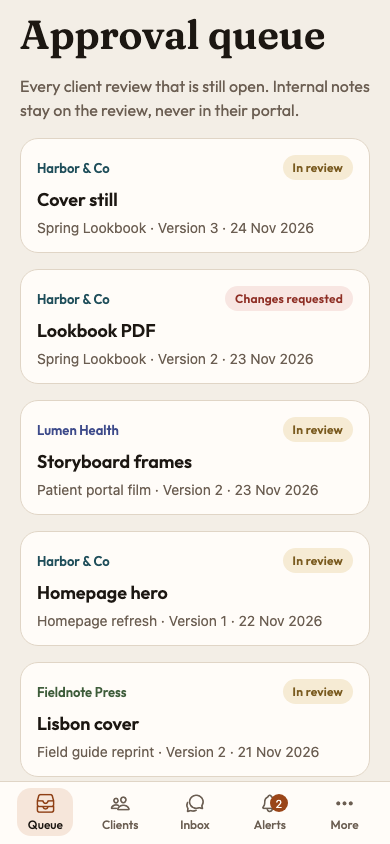
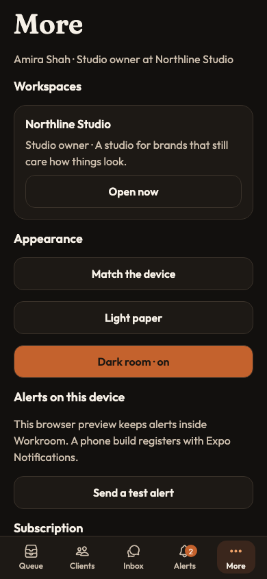

# Workroom

Workroom is the mobile client portal for a multi-tenant agency. A client sees only their branded workspace: projects, milestones, deliverables, and the messages the studio meant them to see. A studio member sees the approval queue across every client, including internal notes that never leave the studio.

This app is the mobile companion to the Workroom web SaaS. It talks to the same Supabase project when you provide the public URL and anon key. With no environment variables, it runs a seeded demo on the device.

Bundle identifier: `com.quvantic.workroom`. Web preview target: [workroom-app.quvantic.com](https://workroom-app.quvantic.com).

## Screens













## Features

- Sign in with email and password, or a magic link. In the demo, the magic link opens from an on-device inbox.
- Try the demo as Harbor & Co (client), Northline Studio (agency), or Fieldnote Press (a client who also has a studio seat).
- Org switcher. Casey Lin can move between Fieldnote and Northline. The role, tabs, and data change with the seat.
- Client portal: branded home, projects, milestones, image and file previews, approve or request changes with a note.
- Threaded project messages. Internal threads stay with the studio.
- Alerts, with a test alert that also schedules a local notification when the device supports Expo Notifications.
- Studio approval queue across clients, client list, and replies. Internal notes are labeled and are not returned to client seats.
- Light, dark, and system appearance.
- Offline banner and a read-through cache of the last successful workspace reads.
- Deep links for reviews, projects, threads, and magic-link callbacks (`workroom://` and `https://workroom-app.quvantic.com`).
- Stripe test-mode subscription shown as read-only. The app never holds a Stripe secret or a Supabase service-role key.

## Architecture

```
src/app            Expo Router screens
src/domain         Roles, visibility rules, formatting
src/data           Repository interface, mock store, Supabase adapter, read cache
src/ui             Design system, review decisions, previews
supabase/migrations Tenant schema and row level security
```

Every screen talks to `WorkroomRepository`. `createRepository` picks the implementation:

| `EXPO_PUBLIC_SUPABASE_URL` | `EXPO_PUBLIC_SUPABASE_ANON_KEY` | Mode |
| --- | --- | --- |
| empty | empty | Mock. Seeded Northline workspace, persisted on device. |
| set | set | Supabase. The signed-in user's JWT. Row level security applies. |

The active organization is part of the boundary. In Supabase it lives in `active_orgs` and policies read it, so a person who belongs to both a client and the studio does not see internal notes while their active seat is the client. The mock store applies the same rule. Writes go through SQL functions (`decide_deliverable`, `add_deliverable_note`, `post_message`) so a client cannot insert an internal note by calling the table directly.

Client roles: `client_admin`, `client_member`. Studio roles: `agency_owner`, `agency_member`.

## Demo seats

These passwords exist only in the mock workspace.

| Person | Workspace | Email | Password |
| --- | --- | --- | --- |
| Lena Okonkwo | Harbor & Co, client | lena@harborandco.example | harbor-demo |
| Amira Shah | Northline Studio, owner | amira@northline.example | northline-demo |
| Jonah Ellis | Northline Studio | jonah@northline.example | northline-demo |
| Priya Raman | Lumen Health, client | priya@lumenhealth.example | lumen-demo |
| Casey Lin | Fieldnote Press, and a Northline seat | casey@fieldnote.example | fieldnote-demo |

Lena cannot see Lumen, Fieldnote, draft files, or the sentence that starts “Hold the retouch budget”. Amira can.

## Run

```bash
npm install
npx expo start
```

- Expo Go: scan the QR code from `npx expo start`.
- Web preview: `npm run web` (port 4391), or `npm run build:web` and serve the `dist` folder.
- EAS: profiles in `eas.json` are `development`, `preview`, and `production`. This repo does not run a paid EAS build. `npx eas-cli build --profile preview` needs an Expo account when you want a device binary.

Copy `.env.example` to `.env` only when you have a Supabase project. Leave both values empty to stay on the demo.

Apply `supabase/migrations/20261125120000_init.sql` in the Supabase SQL editor before pointing the app at that project. Create users in Supabase Auth, add `memberships`, and call `switch_organization`. The web app is expected to own Stripe webhooks and write `subscriptions`. The mobile app only reads that row.

## Tests

```bash
npm test                 # Jest + React Native Testing Library
npm run lint
npm run typecheck
npm run build:web
npm run test:e2e         # Playwright against the web export
npm run screenshots      # refresh docs/screenshots from the web export
```

Maestro flows live in `.maestro/` for the client review, change request, studio queue, and org switch. They target `com.quvantic.workroom` and need a dev build or simulator. CI runs lint, typecheck, unit tests, the web export, and Playwright on `ubuntu-latest` with no secrets.

## What a human still has to do

- Apple Developer and Google Play accounts before a store build.
- An Expo account if you want EAS to produce the binary.
- A real Supabase project URL and anon key, plus the migration applied there.
- DNS for `workroom-app.quvantic.com` pointing at the hosted web export.
